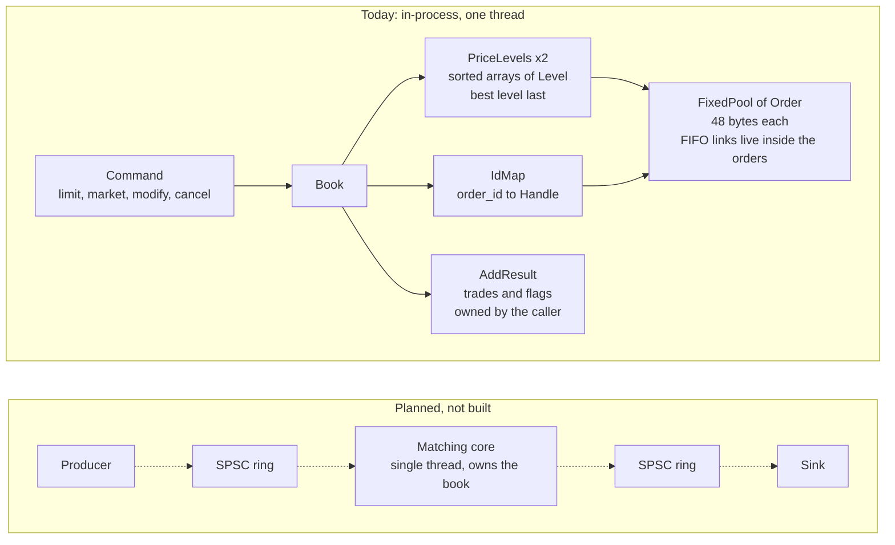
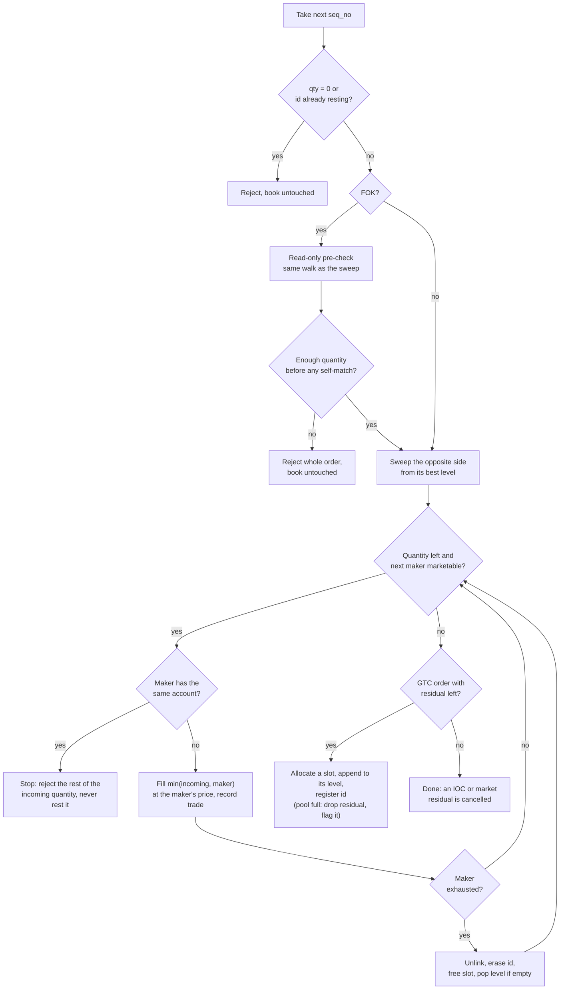
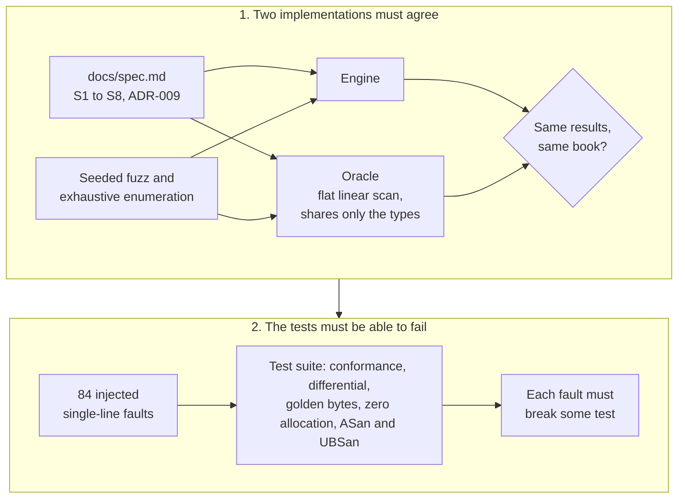
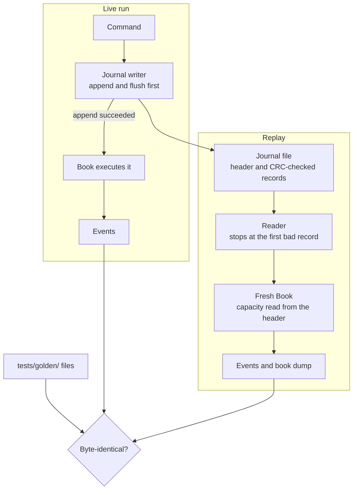
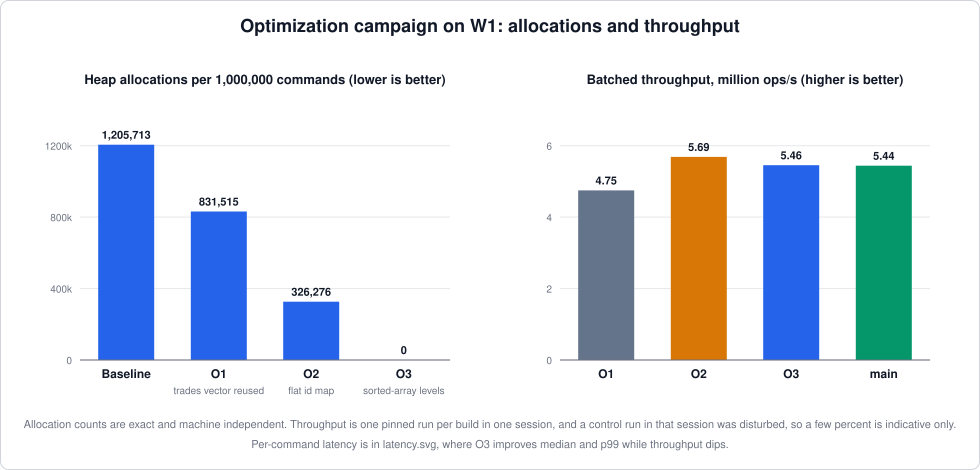
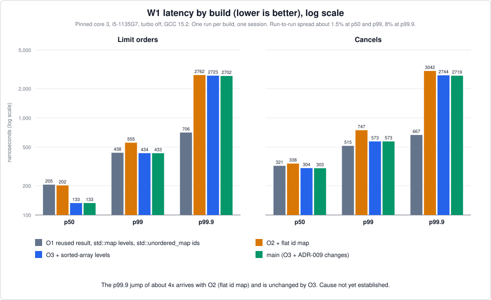

# limit-order-matching-engine

[](https://github.com/akshatsinghrajawat/limit-order-matching-engine/actions/workflows/ci.yml)


A single-threaded limit order matching engine in C++17, built around three properties: **specified** behaviour (every rule is written down before it is coded), **cross-checked** correctness (an independent oracle, exhaustive search and mutation testing), and **reproducible** output (a journal that replays to byte-identical results). After warm-up the hot path makes zero heap allocations, and every performance claim comes with a versioned benchmark methodology.

Where something is slow, unmeasured or unfinished, this README says so. Section 12 is a log of the bugs and wrong decisions found along the way, including a performance conclusion of mine that a pinned-core measurement overturned.

**Contents**
[Overview](#1-overview) · [Status](#2-status) · [Quick start](#3-quick-start) · [Worked example](#4-worked-example) · [Semantics](#5-semantics) · [Architecture](#6-architecture) · [Design decisions](#7-design-decisions-and-the-alternatives-that-lost) · [Verification](#8-verification) · [Determinism and replay](#9-determinism-and-replay) · [Performance](#10-performance) · [What is not done](#11-what-is-not-done) · [Engineering log](#12-engineering-log-what-went-wrong) · [Reproducing](#13-reproducing-everything) · [Repository layout](#14-repository-layout)

---

## 1. Overview

| | |
| --- | --- |
| Order types | Limit (GTC, IOC, FOK), market, cancel, modify |
| Order protection | Self-trade prevention per account |
| Priority | Strict price-time: best price first, FIFO within a price |
| Fill price | Always the resting order's price |
| Numeric model | `int64` price ticks (tick size 1), `uint32` lots. No floating point anywhere in engine state |
| Time | No wall-clock time in engine state. Ordering comes from a sequence number the core assigns itself |
| Memory | Fixed-size pool allocated once at construction. No `new`, `delete` or `shared_ptr` in the engine |
| Allocation on the hot path | 0 per command on workload W1 after warm-up, enforced by a test |
| Determinism | Output is a pure function of the command sequence. A golden journal and golden event log are compared byte for byte in CI |
| Verification | Conformance tests, differential fuzzing against an independent oracle, exhaustive state-space search, mutation testing, ASan and UBSan on every test build |
| Dependencies | Standard library and CMake only |

**What this is not:** a trading system. It is one instrument, one tick size, in-process, with no network layer. The goal is a small core whose behaviour can be fully specified and fully checked, and then made fast without breaking either.

## 2. Status

M0 to M4 are done except the crash-recovery test. The first three allocation-removal steps (O1 to O3) are done and measured on a pinned core: throughput is up about 15% and the hot path allocates nothing, but the tail above p99.9 got about four times worse at O2 and has not been explained yet (see [section 10](#10-performance)).

| Milestone | Scope | State |
| --- | --- | --- |
| M0 | Spec (S1 to S8) and ADRs | done |
| M1 | Order pool, intrusive level lists, matcher, conformance tests | done |
| M2 | Reference oracle, differential fuzz, exhaustive search, mutation check | done |
| M3 | Benchmark harness, harness self-validation, W1 baseline | done |
| M4 | Journal format, replay, golden-file CI | done |
| M4 | Crash-recovery test (SIGKILL at random journal offsets) | not started |
| M5 | O1 to O3: remove every hot-path allocation | done and measured (pinned core) |
| Next | Find the cause of the p99.9 increase that arrived with O2 | not started |
| Later | Page-table price levels (needs a price band in the spec) | not started, motivation weakened by the O3 measurements |
| Later | SPSC ring buffers around the core, cache-line layout, prefetching, ingress batching | not started |

## 3. Quick start

```bash
cmake -S . -B build -DCMAKE_BUILD_TYPE=Debug
cmake --build build --parallel
ctest --test-dir build --output-on-failure
```

- Header-only engine in `include/engine/`. Requires a C++17 compiler (developed on GCC 13 to 15, CI on Ubuntu 26.04).
- Sanitizers are **on by default** (`-fsanitize=address,undefined`). Determinism and memory safety are part of the spec (S7), not an extra. Pass `-DENABLE_SANITIZERS=OFF` for benchmark builds only.
- `ctest` runs 16 test programs in under a minute on a laptop. The long runs live in CI: 100 seeds x 1,000,000 commands of differential fuzz, the full-depth exhaustive search, and the mutation check.

## 4. Worked example

```cpp
#include "engine/book.hpp"
using namespace engine;

Book book(1024);        // pool capacity: the most orders that can rest at once
Book::AddResult r;      // reuse one result so the hot path does not allocate

book.add_limit_order(r, /*id=*/1, Side::Sell, /*price=*/101, /*qty=*/10, /*account=*/7);
book.add_limit_order(r, 2, Side::Sell, 101, 5, 8);
book.add_limit_order(r, 3, Side::Sell, 102, 20, 9);
book.add_limit_order(r, 4, Side::Buy, 99, 30, 10);

book.add_limit_order(r, 5, Side::Buy, 102, 18, 11);                       // sweeps
book.add_limit_order(r, 6, Side::Buy, 102, 100, 12, TimeInForce::FOK);    // all or nothing
book.add_limit_order(r, 7, Side::Buy, 102, 100, 12, TimeInForce::IOC);    // take what is there
book.add_limit_order(r, 8, Side::Sell, 100, 5, 13);                       // rests above the 99 bid
book.modify_order(4, 100, 30);                                             // would trade: rejected
book.modify_order(4, 98, 10);                                              // reposition: applied
book.cancel_order(4);

Book other(16);                                                            // self-trade prevention
other.add_limit_order(r, 1, Side::Sell, 150, 5, /*account=*/20);
other.add_limit_order(r, 2, Side::Buy, 150, 5, /*account=*/20);           // same account: rejected
```

Output of the full program (compiled and run under ASan and UBSan against the code in this repository):

```
sell 10 @101 (id 1)            accepted=1 rested=10 stp=0 trades=0
sell  5 @101 (id 2)            accepted=1 rested=5 stp=0 trades=0
sell 20 @102 (id 3)            accepted=1 rested=20 stp=0 trades=0
buy  30 @99  (id 4)            accepted=1 rested=30 stp=0 trades=0
buy  18 @102 (id 5)            accepted=1 rested=0 stp=0 trades=3
    trade #0  maker=1 taker=5  10 @ 101  seq=4
    trade #1  maker=2 taker=5  5 @ 101  seq=4
    trade #2  maker=3 taker=5  3 @ 102  seq=4
FOK buy 100 @102 (id 6)        accepted=1 rested=0 stp=0 trades=0
IOC buy 100 @102 (id 7)        accepted=1 rested=0 stp=0 trades=1
    trade #3  maker=3 taker=7  17 @ 102  seq=6
sell  5 @100 (id 8)            accepted=1 rested=5 stp=0 trades=0
modify id 4 to 100 (would trade)  -> rejected
modify id 4 to 98, qty 10          -> applied
cancel id 4                        -> done
cancel id 4 again                  -> unknown id

sell 5 @150 (id 1, acct 20)    accepted=1 rested=5 stp=0 trades=0
buy  5 @150 (id 2, acct 20)    accepted=1 rested=0 stp=1 trades=0
```

What to notice:

- Order 5 buys at 102 but pays **101** for the first 15 lots: fills happen at the maker's price. Order 1 fills before order 2 at the same price (FIFO).
- All three trades carry `seq=4`, the sequence number of the command that caused them. A command's sequence number is its position in the input (ADR-009).
- Order 6 (FOK) finds 17 lots and needs 100, so it is rejected and the book is untouched. Order 7 (IOC) takes the same 17 lots and drops the rest.
- Moving order 4's bid to 100 would cross the resting ask at 100, so the modify is rejected and the book is never left crossed. Moving it to 98 with a smaller quantity is a legal reposition.
- In the last two lines the same account is on both sides. The incoming buy is rejected (`stp=1`, no trades) and the resting sell is left alone.

## 5. Semantics

All rules live in [`docs/spec.md`](docs/spec.md) (S1 to S8). Anything the first draft left open was settled in [ADR-009](docs/adr/ADR-009-spec-gaps.md) **before** a golden file was generated, because golden files turn whatever the engine happens to do into a permanent test.

### Commands

| Command | Effect |
| --- | --- |
| `add_limit_order(id, side, price, qty, account, tif)` | Crosses against the opposite side while the price allows, then rests the residual if `tif` is GTC |
| `add_market_order(id, side, qty, account)` | No price bound. Fills until the quantity is exhausted or the book is empty. The remainder is cancelled |
| `modify_order(id, new_price, new_qty)` | Repositions a resting order. Never trades |
| `cancel_order(id)` | Removes a resting order. Returns false for an unknown, filled or already-cancelled id |

### Matching rules (S5, S6)

- **Price-time priority.** The best opposite level is matched first. Within a level, the order that arrived first fills first. "Arrived" means accepted by the engine, not received by a queue in front of it.
- **Fill price.** Every trade executes at the resting order's price, never the incoming order's.
- **Partial fills.** A partly filled resting order stays at the front of its level with its original priority.
- **GTC / IOC / FOK.** GTC rests any residual. IOC cancels it. FOK first checks how much is available at its limit, and if that is less than the order's quantity it is rejected whole, without touching the book.
- **FOK and self-trade prevention agree.** The FOK pre-check walks the book the same way the crossing loop does, including stopping at a self-match. A pre-check that ignored this would say yes, then cross, then stop partway and leave a partial fill behind. Conformance test 14b exists for exactly that case.
- **Pool full.** If a limit order's residual cannot rest because the pool is full, only the residual is dropped and flagged (`pool_exhausted`). Trades it already made stand.

### Modify (S2)

- A modify never frees the order's pool slot, so its handle and id stay stable for its whole life. Only a cancel frees a slot.
- Reducing quantity at the same price keeps time priority and updates in place.
- Increasing quantity or changing price moves the order to the back of its level (or a new level) with a new sequence number.
- A modify that would cross the book is rejected (ADR-009). A caller who wants the trade cancels and resubmits.
- A same-level reposition is unlink then append as one operation. Swapping in place while still linked corrupts FIFO order for every order behind it (conformance test 12b).

### Self-trade prevention (S3)

When an incoming order reaches a resting order with the same account, the incoming quantity is rejected and the resting order is untouched. Trades made before the self-match stand. This is the simplest deterministic policy and needs no relinking on the resting side. Real venues offer several policies (cancel oldest, cancel both, decrement); only this one is implemented.

### Sequencing and atomicity (S6, S8)

- The core assigns `seq_no` itself, one per command, in the order commands are processed. There is exactly one source of ordering truth, and producers never supply it.
- Every command takes a sequence number whether or not it changes the book, so a command's number is its position in the input. Trades carry the number of the command that made them. A resting order carries the number of the command that rested or last repositioned it.
- Each command runs to completion before the next starts. This is atomic by construction (one thread), not by a lock. Any future change to the dequeue loop (for example ingress batching) must state in its ADR how it preserves this.

### Determinism rules (S7)

- Output is a pure function of the command sequence.
- Hash maps are used for lookup only and are never iterated where output depends on the order.
- No floating point and no wall-clock time in engine state. Timestamps may exist only in the journal wrapper.
- Every test build runs under ASan and UBSan.

## 6. Architecture

### Current shape and planned shape



The planned pipeline is deliberately last, so concurrency is added to a core that is already proven correct.

### Data structures

| Piece | What it is | Why |
| --- | --- | --- |
| `FixedPool<Order>` | One vector allocated at construction, never resized. Free slots form an intrusive list threaded through the slots themselves | No allocator calls. Direct indexed access makes cancel and modify O(1) |
| `Handle` | 64 bits: pool index in the low 32, generation in the high 32. The generation increments when a slot is freed | A stale handle fails validation instead of silently aliasing whatever order now occupies the slot. Tests 8b and 8c force this case |
| `Order` | 48 bytes (measured), hot fields first: price, qty, next, prev, side. Cold fields after: id, account, seq_no | Under one 64-byte cache line, so a separate hot/cold array split would only add indirection |
| `Level` | `price`, `head`, `tail` (pool indices) | An order's links live in the order itself, so a level is three words |
| FIFO per level | Intrusive doubly linked list through pool slots | Append, cancel and fill-from-front are O(1) with no node allocation |
| `IdMap` | Flat open-addressed table of 16-byte entries. Power-of-two size at least twice the pool capacity, linear probing, splitmix64 mixing, backward-shift erase, never grows | Replaced `std::unordered_map`, which allocated a node per insert. No tombstones, so cancel-heavy workloads do not lengthen probe runs |
| `PriceLevels` | One array per side sorted worst to best, so the best level is the last element. Allocated once for pool capacity + 1 levels | Matching touches the best level and sweeps remove from that end, so both are O(1) with no shifting. **Interim container, see below** |

### The matching loop

For an incoming limit order the core does this, in order:

1. Take the next `seq_no`. Reject a zero quantity or an id that already rests.
2. If FOK, run the read-only pre-check. Reject whole if the available quantity is short.
3. Walk the opposite side from its best level. At each level, walk the FIFO from the head. For each maker: stop on a self-match, otherwise fill `min(incoming, maker)` at the maker's price and record the trade. A fully filled maker is unlinked, removed from the id map and freed. A drained level is popped from the array end.
4. If the order is GTC with a residual and no self-match stopped it, allocate a slot, append it to its level (creating the level if needed) and register its id.



### Complexity

`L` is the number of price levels on a side.

| Operation | Cost |
| --- | --- |
| Id lookup | O(1) expected |
| Cancel | O(1) unlink, plus an O(L) array shift if the level empties away from the touch |
| Rest at an existing level | O(log L) to find the level, O(1) to append |
| Rest at a new level | O(log L) search plus O(L) memmove |
| Match against the touch | O(1) per fill, because the best level is the last array element |
| Modify | O(1) for a reduce, otherwise cancel plus rest cost |

The O(L) shifts are the known worst case of the price-level container. On W1 they were not the bottleneck (section 10), so the page table that would remove them is deferred until a measurement says they matter.

### Memory behaviour

The pool, id table and level arrays are sized from one number, the pool capacity, when the `Book` is built. Nothing grows afterwards. Level arrays hold capacity + 1 levels per side because the resting step creates a level before it learns the pool is full. A full pool is a clean rejection, not a crash. The id table costs 16 bytes per entry at twice the pool capacity, so a pool of 65,536 orders gets a 2 MiB table.

## 7. Design decisions and the alternatives that lost

Each decision has an ADR with the numbers behind it. The right column is what was rejected and why.

| Decision | Alternative rejected | Why |
| --- | --- | --- |
| Generation-counted handles ([ADR-001](docs/adr/ADR-001-order-storage.md)) | Raw indices | A stale index silently aliases a reused slot, so a late cancel corrupts someone else's order |
| Fixed pool, no heap ([ADR-001](docs/adr/ADR-001-order-storage.md)) | `shared_ptr<Order>` | Allocates per order. Incompatible with the zero-allocation requirement |
| Single `Order` struct, hot fields first ([ADR-002](docs/adr/ADR-002-hot-cold-split.md)) | Struct-of-arrays | At 48 bytes the whole order fits one cache line, so splitting adds an indirection and no locality |
| Intrusive list per level ([ADR-004](docs/adr/ADR-004-fifo-intrusive-list.md)) | `std::list` | Node allocation per insert |
| Flat open-addressed id map ([ADR-005](docs/adr/ADR-005-order-id-lookup.md)) | `std::unordered_map` | One heap node per insert was 42% of all allocations |
| Backward-shift erase ([ADR-005](docs/adr/ADR-005-order-id-lookup.md)) | Tombstones | W1 is 30% cancels, so tombstones would pile up and lengthen every probe |
| Table at most half full ([ADR-005](docs/adr/ADR-005-order-id-lookup.md)) | Denser table | About 1.5 probes per hit and 2.5 per miss at the limit. Memory is the price |
| Caller-owned `AddResult` ([ADR-008](docs/adr/ADR-008-allocation-sources.md)) | Return a fresh result | The trades vector was 31% of allocations. The by-value forms still exist and still allocate |
| Journal is replay authority ([ADR-006](docs/adr/ADR-006-event-log-journal.md)) | Replay from the event vector | Two records of "what happened" can diverge after a batching change. The journal is what ingress actually fed the core |
| Per-record CRC-32 ([ADR-010](docs/adr/ADR-010-journal-format.md)) | One checksum per file | A torn final record should not invalidate every record before it |
| Fixed record size per kind ([ADR-010](docs/adr/ADR-010-journal-format.md)) | Length field | A length field is one more thing a flipped bit can corrupt |
| No `fsync` per command ([ADR-010](docs/adr/ADR-010-journal-format.md)) | `fsync` each record | A flush survives process death. `fsync` costs a disk round trip per command and only buys power-loss safety, which is not claimed |
| Sorted-array levels ([ADR-003](docs/adr/ADR-003-price-level-container.md)) | `std::map` (kept as the baseline) | `std::map` was the last allocation source. The array removes it, and on the pinned-core W1 run it also lowered median and p99 latency. Its worst case, a deep book with a level erased far from the touch, shifts kilobytes (section 10) |
| Reject a crossing modify ([ADR-009](docs/adr/ADR-009-spec-gaps.md)) | Let modify trade | Keeps the book never-crossed and keeps modify a pure reposition |

## 8. Verification

The engine and its checker share only the type aliases, so a bug has to be written twice to survive.



| Layer | What it checks | Where |
| --- | --- | --- |
| Conformance tests (1 to 19, with variants 8b, 8c, 12b, 12c, 12d, 14b) | Resting, crossing, sweeps, partial fills, FIFO, cancel, modify, IOC, FOK, market, self-trade prevention, invalid input, stale handles, pool exhaustion | `tests/conformance/` |
| Reference oracle | A flat, linear-scan model of the spec with no pool, handles or lists | `tests/support/oracle.hpp` |
| Differential fuzz (test 20) | Seeded random streams through engine and oracle in lockstep, comparing every result and periodically the full book. CI: 100 seeds x 1,000,000 commands in an optimized sanitized build. Zero divergences. The generator must actually produce rejected crossing modifies | `tests/fuzz/fuzz_diff.cpp` |
| Exhaustive search (test 21) | Every command sequence to a fixed depth over a small alphabet, three passes, about 137 million prefixes at full depth | `tests/fuzz/exhaustive_diff.cpp` |
| Invariant checker | After commands: list links agree in both directions, tails are right, no cycles, no empty levels, levels strictly ordered, each order sits at its own price and side, no zero-quantity resting order, sequence numbers increase within a level, the id map matches the pool exactly, pool slots in use equal linked orders, and the book is not crossed | `Book::invariant_violation()` |
| Mutation testing | 84 hand-written single-line faults in the engine headers. Each is applied to a copy, rebuilt, and the suite must fail. All 84 killed. A survivor fails CI | `tools/mutation_check.sh` |
| Determinism (tests 22, 23) | Replay is identical twice and equal to the live run; golden journal, event log and book compared byte for byte | `tests/replay/` |
| Zero allocation (test 25) | No `operator new` call across W1 (three seeds) and a stress stream covering IOC, FOK, market, modify, self-trade, duplicate ids and a full pool of 8 | `tests/bench/test_zero_alloc.cpp` |
| Harness validation (tests 26, 27) | Timer noise floor and measurement overhead | `bench/`, `tests/bench/` |
| Sanitizers (test 24) | ASan and UBSan on every test build, locally and in CI | `CMakeLists.txt`, `.github/workflows/ci.yml` |

**What mutation testing showed.** The conformance tests alone missed bugs that the differential tests caught. In the first mutation run, 5 of 19 mutants were killed only by the oracle comparison: strict crossing on the sell side, an equal-quantity modify losing priority, a modify not advancing the sequence number, a filled order left in the id map, and a failed rest leaking an empty level. Most of the replay mutants are killed only by the golden files. That is the reason those layers exist.

**What this does not establish.**
- The engine and the oracle were written from the same spec by the same author. Differential testing catches implementation slips, not a misreading both share. That is why the open spec points were recorded as ADR-009 instead of being left implicit.
- The mutants are a hand-picked list, not a systematic operator set. All killed means these faults are caught, not that no fault survives.
- Fuzzing and exhaustive search cover the spec as written. They say nothing about behaviour a real venue has and this spec omits (auctions, other STP policies, multiple instruments).

## 9. Determinism and replay

### Journal format ([ADR-010](docs/adr/ADR-010-journal-format.md))

A 20-byte header, then one record per command, nothing in between. All integers little-endian and written byte by byte, so the file is identical on every machine and compiler.

| Header bytes | Field |
| ---: | --- |
| 0 to 7 | magic `LOMEJRNL` |
| 8 to 11 | format version (1) |
| 12 to 15 | pool capacity the book was built with |
| 16 to 19 | CRC-32 of bytes 0 to 15 |

| Kind | Command | Payload | Record size |
| ---: | --- | --- | ---: |
| 1 | limit | id u64, side u8, tif u8, price i64, qty u32, account u32 | 31 bytes |
| 2 | market | id u64, side u8, qty u32, account u32 | 22 |
| 3 | cancel | id u64 | 13 |
| 4 | modify | id u64, price i64, qty u32 | 25 |

Each record ends with a CRC-32 of its kind byte and payload. There is no length field and no stored sequence number, because the sequence number is the record's position and storing it would store one fact twice. The header carries the pool capacity because a full pool changes what a command does, so a replay into a differently sized book could diverge with every record intact.

The reader stops at the first bad record and reports why (`Truncated`, `BadChecksum`, `BadKind`, `BadField`) together with the length of the valid prefix. The writer flushes each record and a caller appends before it runs the command.

### Replay and golden tests



- Replay builds a book from the header's capacity, applies records in order and stops at the first bad one, so a torn or corrupted journal replays exactly to its valid prefix.
- **Test 22** replays twice and requires identical bytes, requires replay to equal the live run, and exercises every truncation point and every single-bit flip of a journal.
- **Test 23** compares a checked-in golden journal, event log and final book (`tests/golden/`, a fixed seed and 400 commands) byte for byte. Any change in engine output breaks the build and has to be regenerated deliberately with `test_golden --update`, so a behaviour change cannot pass as a refactor. Separately, the journal unit test checks the writer against bytes produced by an independent Python encoder (`tools/journal_golden.py`), so the layout is what the ADR says and not merely what the writer and reader agree on.

### Known gaps in the journal

No `fsync` (survives process death, not power loss). No detection of deleted or reordered records, since each record is checked alone. The reader holds the whole file in memory. Reopening a journal and appending after recovery is not built. The SIGKILL crash-recovery test is the next M4 item.

## 10. Performance

### How to read these numbers

The full methodology is [`docs/benchmark-methodology.md`](docs/benchmark-methodology.md). In short:

- Per-operation latency uses `rdtscp` plus `lfence`. Throughput is timed over a whole batch so it excludes timestamp cost. The two come from separate passes over the same command stream, which must produce the same number of trades or the run aborts.
- The first 100,000 operations are warm-up. A percentile is reported only with at least 100 samples in its bucket. Limit-order and cancel latency are reported separately because their tails differ.
- Every result file starts with an environment block: CPU, pinned core, governor, turbo state, RAM, kernel, compiler and flags, timestamp-counter type and the binary's hash.
- The harness must pass its own checks first. The noise-floor test times an empty region and bounds the p99 spread, and the overhead test quantifies the cost of the timer itself.
- Only pinned-core Linux runs are published. `tools/run_baseline.sh` refuses to run unless the governor is `performance` and turbo is off, and it never overwrites an existing result.

**Workload W1** (versioned, never edited in place): seed 1, 1,000,000 measured operations after 100,000 warm-up, 10,000-tick price span, about 1,000 levels per side, Zipf-distributed prices, about 30% cancels, 50/50 sides, sizes 1 to 100. A fixed cancel probability did not hold the book at any stable depth (at 40% it grew to about 200,000 orders, at 45% it collapsed), so the cancel probability scales with book size. W1 contains limit orders and cancels only.

### Baseline: the first correct version, before any optimization

`std::map` price levels and `std::unordered_map` id lookup. Intel Core i5-1135G7 laptop, core 3 pinned, `performance` governor, turbo off (2.4 GHz), Linux 7.0.0-38, GCC 15.2, `-O3 -march=native -fno-plt`. This is the committed baseline ([`bench/results/`](bench/results)); the runner of that commit builds a fresh result per command.

| Metric | Value |
| --- | ---: |
| Throughput | 4,653,363 ops/s |
| Limit order p50 / p99 / p99.9 | 206.7 / 484.0 / 776.3 ns |
| Cancel order p50 / p99 / p99.9 | 322.8 / 530.7 / 813.9 ns |

A second full run on that day agreed on throughput to 0.07% and on p50 and p99 within 1.5%, so smaller differences are not evidence. The p99.99 column did not reproduce between runs and is not quoted. The timer's own overhead (about 21 ns) is not subtracted.

**A re-run of the baseline commit on 2026-11-04 was disturbed and is not used.** Same machine and settings, kernel now 7.0.0-42, it gave 3,962,733 ops/s with p99.9 around 20 us (against 776 ns on baseline day) while the runs after it were clean, which points to interference during that run, not to the engine. The files are kept in `bench/results/` (`*-m3-repeat-*`) because deleting an unflattering run would be worse than explaining it. Because of this, **the comparisons below are all within one session on 2026-11-04, never against the baseline-day numbers.**

### Optimization campaign: allocations

Allocation counts do not depend on timing, so they are exact and need no tuned machine. They are counted with a replaced global `operator new` over W1 seed 1, 1,000,000 measured commands.

| Step | Change | Allocations | Per command |
| --- | --- | ---: | ---: |
| Baseline | | 1,205,713 | 1.21 |
| O1 | Reuse one caller-owned `AddResult` for trades | 831,515 | 0.83 |
| O2 | Flat open-addressed id map | 326,276 | 0.33 |
| O3 | Preallocated sorted-array price levels | **0** | 0 |

Where the baseline's allocations came from, measured by wrapping each call site (ADR-008):

| Source | Allocations | Share |
| --- | ---: | ---: |
| `trades.push_back` in the crossing loop | 374,198 | 31% |
| id map insert | 505,239 | 42% |
| price level node | 326,276 | 27% |
| everything else, cancels included | 0 | 0% |



The three rows add up to the total exactly. The counts for O1, O2 and O3 are identical on GCC 13.3 and on the benchmark machine's GCC 15.2. Only `operator new` is counted, so a direct `malloc` would not show up.

### Optimization campaign: latency

One run per version, all in the same session on 2026-11-04: core 3 pinned, `performance` governor, turbo off, GCC 15.2, W1 seed 1, 1,000,000 measured operations. Each version was built from its own commit. "main" is the current head, which adds the ADR-009 and journal changes on top of O3.

| Version | Throughput (ops/s) | Limit p50 / p99 / p99.9 (ns) | Cancel p50 / p99 / p99.9 (ns) |
| --- | ---: | ---: | ---: |
| O1: reused result, `std::map` + `std::unordered_map` | 4,747,865 | 205.4 / 437.7 / 706.0 | 321.2 / 515.0 / 667.2 |
| O2: + flat id map | 5,687,100 | 201.7 / 555.1 / 2,762.1 | 338.5 / 746.9 / 3,041.9 |
| O3: + sorted-array levels | 5,455,611 | 132.7 / 433.6 / 2,722.8 | 304.2 / 572.9 / 2,743.5 |
| main | 5,440,715 | 132.7 / 432.8 / 2,702.5 | 303.4 / 572.9 / 2,719.1 |



What the table says, from O1 to main:

- **Throughput +14.6%.** Median limit latency **-35%** (205.4 to 132.7 ns), median cancel -5.5%, limit p99 unchanged.
- **Cancel p99 +11%** and **p99.9 about 4x worse** for both order kinds (706 to 2,702 ns limit, 667 to 2,719 ns cancel). The p99.9 jump arrives at O2 and O3 does not change it.
- **O2 to O3:** limit p50 -34%, limit p99 -22%, cancel p50 -10%, cancel p99 -23%, p99.9 unchanged, but batched throughput **-4.1%** (5.69M to 5.46M).
- **main equals O3** within the spread, so the ADR-009 and journal changes cost nothing measurable on W1.

How much to trust it:

- It is a single run per version. The documented run-to-run spread on this setup is about 1.5% at p50 and p99 and about 8% at p99.9, so the p99.9 jump and the O3 p50 and p99 gains are far outside it. The documented throughput spread on baseline day was only 0.07%, but the control re-run in this session was disturbed (see above), so treat single-run differences of a few percent, including the 4% throughput gap between O2 and O3 and the cancel p50 differences, as indicative and not established.
- The p99.9 level of about 2.7 us shows up in three separate builds (2,762 / 2,723 / 2,703 ns), which argues against a one-off disturbance. A repeat session is the way to confirm.
- The latency passes time each command with `rdtscp` plus `lfence`, which serializes the pipeline, while the throughput pass runs the batch unserialized. They can legitimately disagree (O3 better at p50 and p99 yet slower in batch). I have not isolated why.
- p99.99 and max are not interpreted.

**Cause of the p99.9 increase: not established.** Hypothesis, untested: the benchmark book has a pool of 65,536 orders, so the O2 id table is 131,072 entries of 16 bytes, 2 MiB, hit at effectively random addresses on every command, while only about 3,000 orders are live. The `std::unordered_map` it replaced kept those few thousand nodes close together. If that is right, a smaller table, or a hash that keeps nearby ids nearby, would bring the tail back. Other candidates (probe-run length under backward-shift erase, TLB misses) are equally unmeasured. This is the next item.

### The price-level container

Before the pinned run, an unpinned A/B in a shared sandbox suggested the sorted array was much slower than `std::map` (cancel p99 about ten times worse). **The pinned run on the benchmark machine did not reproduce that.** Cancel p99 went from 746.9 ns (O2, `std::map` levels) to 572.9 ns (O3). The shared sandbox result was an artifact of the environment and has been withdrawn.

The mechanism behind the original worry is real and measured: a level created or erased away from the touch moves every level behind it.

| Operation | Count per 1M commands | Mean levels moved | Mean bytes moved | Most |
| --- | ---: | ---: | ---: | ---: |
| Insert a level | 326,276 | 304.6 | 4.8 KB | 1,167 |
| Erase a level | 159,155 | 622.5 | 9.7 KB | 1,165 |

About 3 KB per command on average, and on this machine it does not dominate: the copies are sequential, hardware-prefetched memory moves, cheaper than the pointer-chasing `std::map` they replaced. The cost scales with the number of levels, so a book much deeper than W1's roughly 1,000 per side would move more. W1 is the only workload run, so no claim is made about other book shapes.

The page table (index levels by price offset, no shifting) is therefore deferred. It also needs a spec change, a price band taken at construction with out-of-band orders rejected like an exchange price collar, which gets its own ADR if a measurement ever justifies it.

## 11. What is not done

- **The p99.9 regression that arrived with O2.** About 4x worse than O1 on W1, cause unknown (hypothesis in section 10).
- **Repeat runs.** The latency table is one run per version in one session. A second session, with all power managers stopped, would tighten it.
- **Other workloads.** Only W1 (limit orders and cancels, one account per order). No modify, IOC, FOK, market or self-trade traffic is benchmarked, and no shallow or very deep books.
- **Crash recovery.** The SIGKILL-at-random-offsets test, `fsync`, record-chain integrity and resume-append are not built.
- **Concurrency.** The SPSC ring pipeline is planned and deliberately last.
- **Cache-line layout, branch reduction, prefetching, ingress batching.** Not started. Failed attempts will be documented in the same table as successful ones.
- **Page-table price levels.** Deferred, see section 10.
- **Scope limits.** Single instrument, single tick size, no network layer, no odd-lot book, no auctions, and self-trade prevention is the only protection policy.

## 12. Engineering log: what went wrong

Real defects and wrong decisions, kept because each one changed the process.

| What happened | How it was found | What changed |
| --- | --- | --- |
| A use-after-free: a full pool returned an invalid handle and its index went straight into an unchecked write past the pool | ASan, in M1 | `rest()` checks the handle. Tests 18 and 19 cover pool exhaustion |
| ADR-002 listed `timestamp` as an `Order` field. S7 forbids wall-clock state in the core | Writing the actual struct | Field removed. ADR corrected and the mistake noted in it |
| The spec left four behaviours open (sequence numbers on trades, whether a modify may cross, pool exhaustion, duplicate ids). The oracle had been built to follow the engine on them, which is not the same as deciding them | Review before generating golden files | ADR-009 settles all four |
| A fixed cancel probability gave an unstable book in the workload generator | Long generator runs | Cancel probability scales with book size |
| Power management turned turbo on mid-benchmark. The clock rose from 2.4 to about 3.8 GHz and the timer cost fell from 22 to 12 ns. The noise-floor test passed with a spread of 8.3 ns | The harness's own overhead check | Baseline script refuses unless governor and turbo are right, and the methodology records the case and why the 10 ns limit is too loose |
| The zero-allocation claim was specified in M0 but could not pass until the allocation work was done | Building test 25 | Test 25 fails on the O2 engine and passes only on O3, so it is a real check and not a rubber stamp |
| I concluded from an unpinned, shared-sandbox A/B that sorted-array levels were about 10x worse on cancel tails, and the repo's ADR-003 and a commit message recorded that as a regression | The pinned-core run on the benchmark machine: cancel p99 improved 23% over O2 | The conclusion was withdrawn and the README rewritten from the pinned data. Lesson: a shared-VM A/B can mislead in either direction, so no latency claim is made without a pinned run |
| The re-run of the baseline commit came out 15% slower than the committed baseline with a 20 us p99.9 | Same-session control run | Marked as disturbed and excluded. All comparisons are within one session, never against the baseline-day numbers |
| p99.9 became about 4x worse at O2 while throughput improved | The pinned latency table | Open. Recorded in section 11 with an untested hypothesis |

## 13. Reproducing everything

```bash
# Tests (sanitized)
cmake -S . -B build -DCMAKE_BUILD_TYPE=Debug
cmake --build build --parallel
ctest --test-dir build --output-on-failure

# Long differential fuzz, as in CI (optimized, sanitized)
cmake -S . -B build-rel -DCMAKE_BUILD_TYPE=Release
cmake --build build-rel --parallel --target fuzz_diff exhaustive_diff
./build-rel/fuzz_diff 100 1000000 1 32
./build-rel/exhaustive_diff

# Mutation check (slow, about a minute per mutant)
bash tools/mutation_check.sh

# Allocation counts (any machine)
cmake -S . -B build-allocs -DCMAKE_BUILD_TYPE=Release -DENABLE_SANITIZERS=OFF
cmake --build build-allocs --target bench_allocs
./build-allocs/bench_allocs <label> 1 1000000

# Latency baseline (Linux, pinned core, governor and turbo set; read the methodology first)
tools/run_baseline.sh <cpu> <label>

# Redraw the charts from the committed result files (standard library only)
python3 tools/make_charts.py

# Regenerate the golden files after a deliberate behaviour change
./build/test_golden --update
```

## 14. Repository layout

```
include/engine/     header-only engine: book, pool, id_map, price_levels, level,
                    journal, command, replay, types
tests/conformance/  hand-written spec tests
tests/oracle/       oracle self-checks
tests/fuzz/         differential fuzz and exhaustive search
tests/unit/         id map, price levels, journal
tests/replay/       determinism tests (22, 23)
tests/golden/       checked-in golden journal, event log and book
tests/bench/        tests for the benchmark harness, zero-allocation test (25)
tests/support/      oracle and differential-test helpers (kept out of include/)
bench/              workload generator, timing, runners, allocation counter, results/
tools/              mutation check, baseline runner, journal golden-bytes encoder, chart generator
docs/               spec, benchmark methodology, ADR-001 to ADR-010, img/ (generated charts)
```

Documentation: [`docs/spec.md`](docs/spec.md) (S1 to S8), [`docs/adr/`](docs/adr) (ADR-001 to ADR-010), [`docs/benchmark-methodology.md`](docs/benchmark-methodology.md).

## How this was built

The semantics, the ADRs and the decision to rebuild the project from scratch under a much stricter plan are the author's. The implementation, tests and benchmark harness were written with Claude (Anthropic) as the coding assistant, then reviewed, built, run and committed by the author. That is why the verification layers (independent oracle, mutation testing, golden files, sanitizers, a test that checks the allocation claim) are central to the project and not optional extras.

## License

MIT, see [`LICENSE`](LICENSE).

Author: Akshat Singh Rajawat
